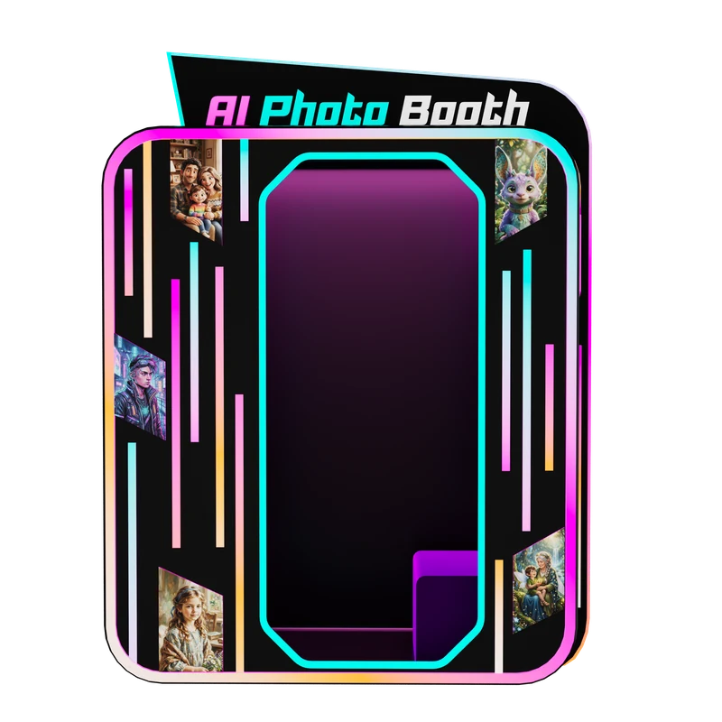
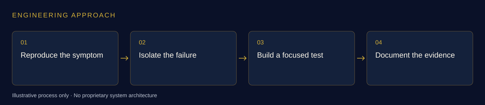

# AI Photo Booth App

### AI-powered application engineering, Android development and diagnostics

**Whitemore Ngwira · Engineering contributions at Sweet Robo**

[Sweet Robo — official website](https://sweetrobo.com/) · [Futureino — official website](https://futureino.ai/) · [Explore the public product page](https://futureino.ai/vending-machines/ai-photo-booth-vending-machine)

  

*Futureino’s published AI Photo Booth product visual. [View source image](https://futureino.ai/machines/ai-photo-booth-angle-front.webp).*

## My work

I provide AI-powered application engineering for the Sweet Robo / Futureino AI Photo Booth app. My contributions include Android development, payment-related application changes, device-communication debugging and diagnostic APKs with repeatable test instructions.

**Skills:** AI-powered applications · Android · Kotlin · Debugging · Payment integration · Diagnostics · Test isolation

## The product context

Futureino publicly describes its AI Photo Booth as a self-service photo experience with AI styling and physical photo and sticker output. [Official source](https://futureino.ai/vending-machines/ai-photo-booth-vending-machine).

## My engineering contributions

- **AI-powered application engineering:** Contribute software engineering, integration and validation within the existing team-owned AI Photo Booth app.
- **Fault investigation:** Reproduced reported symptoms and investigated application and device-communication behaviour to narrow the next test.
- **Application integration:** Contributed payment-related software and diagnostic controls for targeted testing.
- **Diagnostic builds:** Prepared a dedicated test application separated from the normal application, with capabilities restricted to the investigation.
- **Evidence and handover:** Ran automated checks, inspected build properties and documented reproduction steps, test results and the remaining physical checks.

## What I produced

Application changes, focused diagnostic APKs and repeatable test instructions for engineering and factory review.

## Engineering approach

Debugging across an Android application and real peripherals, while keeping software evidence, physical test results and release decisions clearly distinguished.

## AI-powered solutions

The AI Photo Booth app is part of my wider AI solution work for Sweet Robo / Futureino. My related contributions include the [AI-powered management platform, remote diagnostics and camera-AI workflows](https://github.com/whitemorengwira/sweet-robo-control-centre-engineering#ai-powered-solutions).

## AI-assisted engineering

Across my connected-machine work, I use **Claude Code** and **OpenAI Codex** to support code understanding, scoped changes, debugging, verification and technical documentation. I direct the work, review the output and distinguish software checks from physical-machine acceptance.

[See how I use Claude Code and Codex in my engineering workflow](https://github.com/whitemorengwira#software-engineering-with-claude-code--codex). This describes my development method; it does not expose internal agent instructions or proprietary implementation details.

## Explore the engineering series

- [Perfume Machine](https://github.com/whitemorengwira/sweet-robo-perfume-machine)
- [Vending Machine](https://github.com/whitemorengwira/sweet-robo-vending-machine)
- [AI Photo Booth App](https://github.com/whitemorengwira/sweet-robo-photo-booth) — AI-powered application engineering — this showcase
- [Control Centre Engineering](https://github.com/whitemorengwira/sweet-robo-control-centre-engineering) — AI-powered management, remote diagnostics and camera-AI workflows

## Sources and portfolio scope

Official product information and imagery: [Futureino](https://futureino.ai/) and [Sweet Robo](https://sweetrobo.com/). Product descriptions are attributed public context; the first-person contribution statements describe my own work within an existing team.

This documentation-only portfolio excludes proprietary source code, private infrastructure and non-public operational information. It does not imply sole product authorship, employer endorsement or completion of every hardware and release milestone. See [image credits and viewing notice](COPYRIGHT.md).

[Contact me](mailto:hello@nwhite.systems) · [N.White Systems](https://nwhite.systems/) · [GitHub profile](https://github.com/whitemorengwira)
