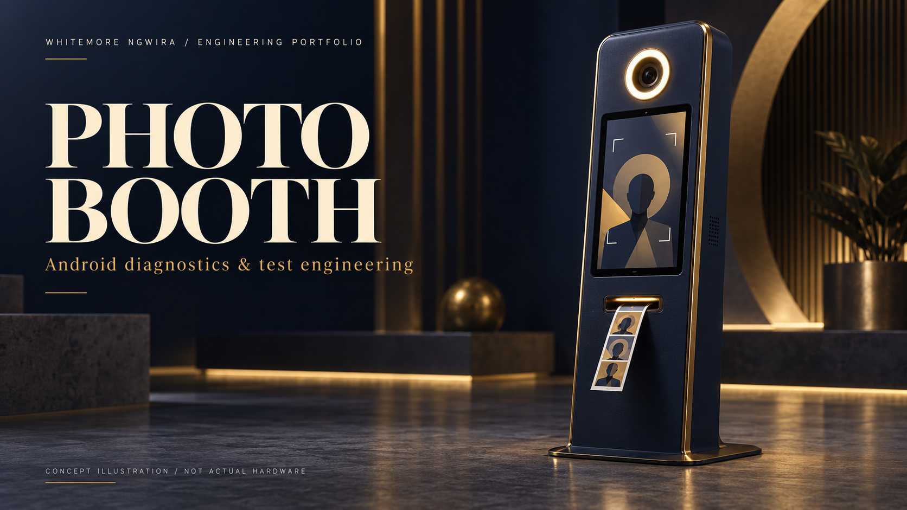

# Photo Booth

### Android diagnostics & test engineering

**Whitemore Ngwira · Sweet Robo · Selected engineering contributions**

*AI-generated concept illustration. The equipment and interface shown are fictional; they are not photographs or screenshots of Sweet Robo products.*

## At a glance

I contributed Android debugging, payment-integration work and diagnostic test-build engineering for photo-booth systems during my work at Sweet Robo.

**Focus:** Application debugging and test engineering  
**Skills demonstrated:** Android · Kotlin · Diagnostics · Payment integration · Test isolation

## The engineering challenge

A photo-booth experience depends on software and several physical peripherals working together. A useful investigation has to separate application behaviour, device communication and the evidence still needed from a real machine.

## My contribution

### Application and peripheral diagnosis

I investigated communication failures and traced symptoms through the application to narrow the next test.

### Integration and diagnostic tooling

I contributed payment-related application work and diagnostic controls that supported targeted testing.

### Isolated test builds

I prepared a dedicated diagnostic build separated from the normal application, with restricted capabilities suited to controlled investigation.

### Evidence and handover

I ran automated checks, inspected build properties and documented reproduction steps, test evidence and the remaining physical checks.

## How I approached the work

*Illustrative debugging process; not the product's payment, camera or printing architecture.*

1. Reproduce the symptom.
2. Isolate the failure.
3. Build a focused test.
4. Document the evidence.

## What the work produced

The work produced application changes, diagnostic test APKs and repeatable test instructions for engineering and factory review.

Automated checks, emulator results and diagnostic builds are different evidence from end-to-end hardware acceptance. This summary makes no blanket claim of successful payments, camera operation, printing or fleet deployment.

## Public review boundary

This is a documentation-only portfolio showcase. Private source code, internal platform names, infrastructure, endpoints, schemas, credentials, customer information, operational records and internal screenshots are excluded. Supporting work records remain private.

The narrative explains my contribution within a team-owned product. The concept artwork is not evidence of implementation or an employer-approved product design.

## Explore the series

- [Perfume Machine](https://github.com/whitemorengwira/sweet-robo-perfume-machine)
- [Vending Machine](https://github.com/whitemorengwira/sweet-robo-vending-machine)
- [Control Centre Engineering](https://github.com/whitemorengwira/sweet-robo-control-centre-engineering)

## Contact

[GitHub profile](https://github.com/whitemorengwira) · [N.White Systems](https://nwhite.systems/) · [Email Whitemore](mailto:hello@nwhite.systems)

I can discuss my engineering approach and responsibilities within the applicable confidentiality boundaries.

See [Portfolio viewing notice](COPYRIGHT.md).

